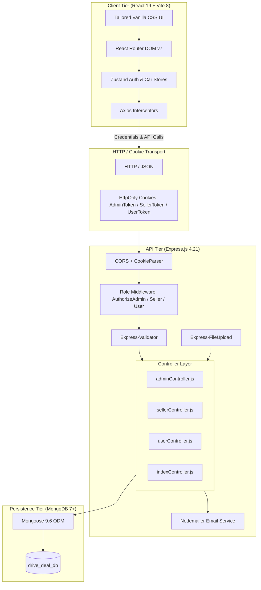
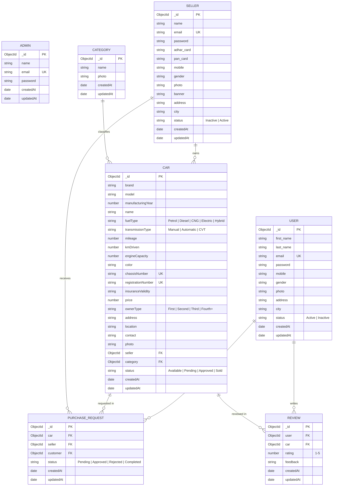
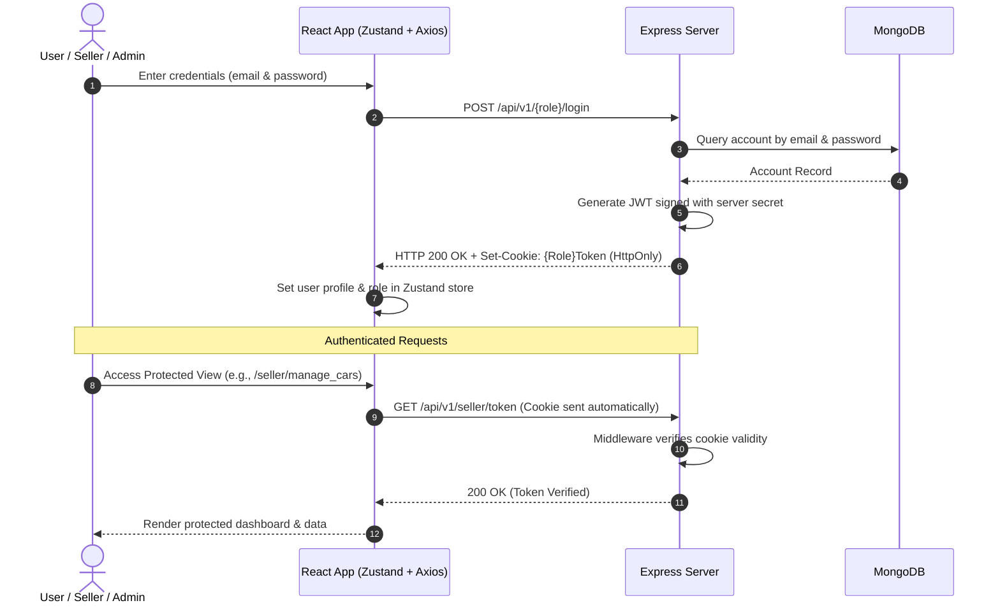
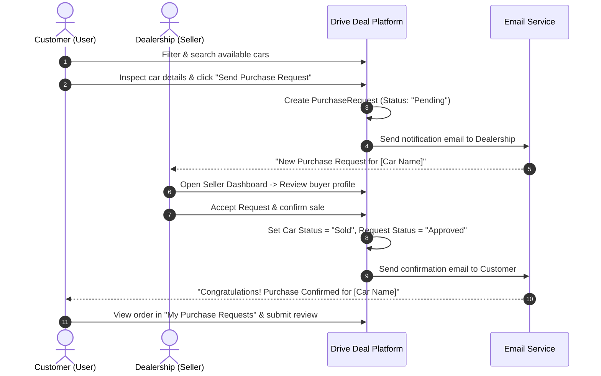

# 🚗 Drive Deal — Full-Stack Automotive Marketplace & Dealership Management System

[](https://nodejs.org/)
[](https://expressjs.com/)
[](https://react.dev/)
[](https://vitejs.dev/)
[](https://www.mongodb.com/)
[](https://github.com/pmndrs/zustand)
[](https://jwt.io/)
[](LICENSE)

---

## 📌 Table of Contents

1. [Executive Summary](#-executive-summary)
2. [Key Capabilities & Features](#-key-capabilities--features)
3. [System Architecture](#-system-architecture)
4. [Technology Stack](#-technology-stack)
5. [Database Schema & Data Models](#-database-schema--data-models)
6. [Authentication & Authorization Flow](#-authentication--authorization-flow)
7. [API Specification](#-api-specification)
8. [Project Directory Layout](#-project-directory-layout)
9. [Getting Started & Local Setup](#-getting-started--local-setup)
10. [Environment Variables](#-environment-variables)
11. [Database Seeding & Test Credentials](#-database-seeding--test-credentials)
12. [User Journeys & Workflow Walkthroughs](#-user-journeys--workflow-walkthroughs)
13. [Email Notification System](#-email-notification-system)
14. [Production Deployment & Security Guidelines](#-production-deployment--security-guidelines)
15. [Contributing & Support](#-contributing--support)

---

## 📖 Executive Summary

**Drive Deal** is an enterprise-grade, multi-tenant digital automotive marketplace designed to bridge vehicle buyers, independent automobile sellers/dealerships, and central platform administrators into a cohesive, streamlined ecosystem.

Traditional car procurement often suffers from fragmented communications, opaque ownership histories, and sluggish inquiry handling. **Drive Deal** solves this by providing:
- **For Buyers**: A modern digital showroom with parametric multi-attribute filtering, side-by-side vehicle comparison, transparent technical specifications, verified seller credentials, and one-click purchase requests.
- **For Sellers / Dealerships**: A digital sales command center to publish listings, upload high-resolution vehicle imagery, track real-time buyer inquiries, manage sales statuses, and automate buyer notifications.
- **For Administrators**: Central governance covering dealership KYC verification (Aadhaar & PAN verification), category taxon management, transaction monitoring, and customer relations.

---

## ✨ Key Capabilities & Features

### 👤 Role-Based Feature Matrix

| Feature | Public / Guest | Customer (User) | Dealership (Seller) | Platform Admin |
| :--- | :---: | :---: | :---: | :---: |
| Browse & Search Vehicle Catalog | ✅ | ✅ | ✅ | ✅ |
| Filter by Category, Fuel, Transmission, Price | ✅ | ✅ | ✅ | ✅ |
| Side-by-Side Car Comparison Tool | ✅ | ✅ | ✅ | ✅ |
| View Detailed Vehicle Specs & Location | ✅ | ✅ | ✅ | ✅ |
| Submit Purchase Request / Inquiries | ❌ | ✅ | ❌ | ❌ |
| Order / Request Status Tracking | ❌ | ✅ | ❌ | ❌ |
| Vehicle Reviews & Star Rating System | Read Only | Submit & Read | Read Only | Moderate |
| User Profile & Password Management | ❌ | ✅ | ✅ | ✅ |
| Add / Edit / Remove Car Listings | ❌ | ❌ | ✅ | ❌ |
| Manage Buyer Purchase Inquiries | ❌ | ❌ | ✅ | ❌ |
| Transition Vehicle State (`Available` → `Sold`) | ❌ | ❌ | ✅ | ❌ |
| KYC Onboarding & Status Tracking | ❌ | ❌ | ✅ (`Inactive` / `Active`) | ❌ |
| Dealership KYC Verification & Approval | ❌ | ❌ | ❌ | ✅ |
| Vehicle Category Management (CRUD + Icons) | ❌ | ❌ | ❌ | ✅ |
| Global Transaction & Inquiry Auditing | ❌ | ❌ | ❌ | ✅ |
| Platform User Directory Inspection | ❌ | ❌ | ❌ | ✅ |
| Automated Transactional Email Notifications | ❌ | ✅ | ✅ | ✅ |

---

## 🏛 System Architecture

The application adopts a decoupled client-server architecture. The frontend is built on **React 19** bundled with **Vite 8**, while the backend is an **Express.js** RESTful API interacting with **MongoDB** via **Mongoose ODM**.

### High-Level Architectural Flow



---

## 🛠 Technology Stack

### Frontend
- **Framework**: [React 19](https://react.dev/) — Latest concurrent rendering engine.
- **Build Tool**: [Vite 8](https://vitejs.dev/) — Lightning-fast ES module development server and Rollup production bundler.
- **Routing**: [React Router DOM v7](https://reactrouter.com/) — Declarative routing with code-splitting (`React.lazy` + `Suspense`) and Protected Route wrappers.
- **State Management**: [Zustand 5](https://zustand-demo.pmnd.rs/) — Minimalist, unopinionated state management with `persist` middleware for persistent auth sessions.
- **Form Handling**: [React Hook Form](https://react-hook-form.com/) — High-performance form state subscriptions and validation.
- **HTTP Client**: [Axios](https://axios-http.com/) — Configured with global error interceptors, 401 redirection hooks, and cookie credential passing.
- **Styling**: Modular Vanilla CSS (`*.module.css`) + CSS Custom Properties (Design tokens for dark glassmorphism, responsive grids, and clean typography).
- **Notifications**: [React Hot Toast](https://react-hot-toast.com/) — Lightweight, animated toast notifications for async feedback.
- **Typography**: Google Fonts ([Outfit](https://fonts.google.com/specimen/Outfit) & [Inter](https://fonts.google.com/specimen/Inter)).

### Backend
- **Runtime Environment**: [Node.js](https://nodejs.org/) (v18.x or v20.x recommended).
- **Web Framework**: [Express.js 4.21](https://expressjs.com/) — Lightweight, unopinionated REST API framework.
- **Database**: [MongoDB](https://www.mongodb.com/) via [Mongoose 9.6](https://mongoosejs.com/) ODM.
- **Authentication**: [JSON Web Tokens (jsonwebtoken)](https://github.com/auth0/node-jsonwebtoken) with symmetric secret signing stored securely in HTTP-only browser cookies.
- **Validation**: [express-validator 7.3](https://express-validator.github.io/docs/) for request body sanitization and rule validation.
- **Multipart Uploads**: [express-fileupload 1.5](https://www.npmjs.com/package/express-fileupload) handling vehicle and profile picture uploads directly to disk storage (`public/`).
- **Email Engine**: [Nodemailer 8.0](https://nodemailer.com/) with styled HTML email templates.
- **Logging**: [Morgan 1.10](https://github.com/expressjs/morgan) for HTTP request telemetry in dev mode.

---

## 🗄 Database Schema & Data Models

The persistence layer uses MongoDB with strict Mongoose validation, referential integrity (`ref`), and schema timestamps.

### Entity Relationship Diagram



---

## 🔐 Authentication & Authorization Flow

Drive Deal implements a role-partitioned authentication strategy utilizing **JWT** and **HTTP-only Cookies**.



### Authorization Middlewares

| Middleware Function | Scope | Cookie Inspected | Target Roles | Failure Action |
| :--- | :--- | :--- | :--- | :--- |
| `AuthorizeAdmin` | Admin Route Navigation | `AdminToken` | Administrator | `401 Unauthorized` |
| `AuthorizeAdmin_HTTP` | Admin API Endpoints | `AdminToken` | Administrator | `401 Unauthorized` |
| `AuthorizeSeller` | Seller Navigation | `SellerToken` | Dealership / Seller | `401 Unauthorized` |
| `AuthorizeSeller_HTTP` | Seller Data APIs | `SellerToken` | Dealership / Seller | `401 Unauthorized` |
| `AuthorizeUser` | User Portal Views | `UserToken` | Registered Customer | `401 Unauthorized` |
| `AuthorizeUser_HTTP` | User Actions (Order/Review) | `UserToken` | Registered Customer | `401 Unauthorized` |

---

## 📡 API Specification

**Base URL**: `http://localhost:5000/api/v1`

### 1. Public Endpoints (`/api/v1`)

| Method | Endpoint | Description | Query / Body Params | Auth |
| :--- | :--- | :--- | :--- | :---: |
| `GET` | `/ping` | Server health check | None | ❌ |
| `GET` | `/fetchCategories` | Fetch all vehicle categories | None | ❌ |
| `GET` | `/fetchcars/:id` | Fetch cars by category or `'all'` | `page`, `limit`, `brand`, `minPrice`, `maxPrice`, `fuelType`, `transmissionType`, `sortBy`, `order` | ❌ |
| `GET` | `/fetchSingleCar/:id` | Fetch full car specs + seller profile | Route Param: `:id` (Car ObjectId) | ❌ |
| `GET` | `/fetchreviews` | Retrieve all customer car reviews | `page`, `limit` | ❌ |

### 2. User Endpoints (`/api/v1/user`)

| Method | Endpoint | Description | Key Payload / Requirements | Auth |
| :--- | :--- | :--- | :--- | :---: |
| `POST` | `/register` | Register customer account | `first_name`, `last_name`, `email`, `password`, `mobile`, `gender`, `address`, `city`, `photo` (file) | ❌ |
| `POST` | `/login` | Authenticate customer | `email`, `password` | ❌ |
| `GET` | `/token` | Verify user session cookie | None | `UserToken` |
| `GET` | `/stats` | Fetch user dashboard metrics | None | `UserToken` |
| `GET` | `/showProfile` | Fetch current user profile | None | `UserToken` |
| `PUT` | `/updateProfile/:id` | Update profile information | `first_name`, `last_name`, `mobile`, `address`, `city` | `UserToken` |
| `PUT` | `/changePassword` | Change user password | `old_password`, `new_password` | `UserToken` |
| `POST` | `/addPurchaseRequest` | Send purchase inquiry for a car | `car` (ObjectId), `seller` (ObjectId) | `UserToken` |
| `GET` | `/fetchMyPurchaseRequests`| Fetch all requests made by user | None | `UserToken` |
| `GET` | `/check_request/:carId` | Check if user already requested car | Route Param: `:carId` | `UserToken` |
| `POST` | `/addreview` | Post a star review & feedback | `car` (ObjectId), `rating` (1-5), `feedback` | `UserToken` |
| `GET` | `/logout` | Invalidate cookie & terminate session | None | `UserToken` |

### 3. Seller / Dealership Endpoints (`/api/v1/seller`)

| Method | Endpoint | Description | Key Payload / Requirements | Auth |
| :--- | :--- | :--- | :--- | :---: |
| `POST` | `/register` | Register dealership account | `name`, `email`, `password`, `adhar_card`, `pan_card`, `mobile`, `gender`, `address`, `city`, `photo` (file) | ❌ |
| `POST` | `/login` | Authenticate seller | `email`, `password` | ❌ |
| `GET` | `/token` | Verify seller session cookie | None | `SellerToken` |
| `GET` | `/stats` | Fetch dealership business analytics | None | `SellerToken` |
| `GET` | `/showProfile` | Fetch seller showroom profile | None | `SellerToken` |
| `PUT` | `/updateProfile/:id` | Update showroom information | `name`, `mobile`, `address`, `city` | `SellerToken` |
| `PUT` | `/changePassword` | Update seller credentials | `old_password`, `new_password` | `SellerToken` |
| `POST` | `/addcar` | Create new vehicle listing | Full car specs + `photo` (file) + `category` (ObjectId) | `SellerToken` |
| `GET` | `/fetchcars` | Fetch all vehicles listed by seller | None | `SellerToken` |
| `PUT` | `/updatecar/:id` | Update vehicle specifications | Car schema fields + optional new `photo` | `SellerToken` |
| `DELETE` | `/deletecar/:id` | Delete vehicle from inventory | Route Param: `:id` | `SellerToken` |
| `GET` | `/fetchcarreq` | Fetch incoming purchase inquiries | None | `SellerToken` |
| `PUT` | `/updatereq/:id` | Accept or reject purchase request | `status` (`'Approved'` / `'Rejected'`) | `SellerToken` |
| `PUT` | `/updateCar/:id` | Mark vehicle as `'Sold'` or `'Available'` | `status` | `SellerToken` |
| `GET` | `/fetchapprovedbooking` | Fetch completed / sold vehicle log | None | `SellerToken` |
| `POST` | `/send-email` | Send direct communication email | `email`, `subject`, `message` | `SellerToken` |
| `GET` | `/logout` | Invalidate seller session | None | `SellerToken` |

### 4. Administrator Endpoints (`/api/v1/admin`)

| Method | Endpoint | Description | Key Payload / Requirements | Auth |
| :--- | :--- | :--- | :--- | :---: |
| `POST` | `/login` | Authenticate platform admin | `email`, `password` | ❌ |
| `GET` | `/token` | Verify admin session cookie | None | `AdminToken` |
| `GET` | `/fetchSeller` | Fetch all registered dealerships | None | `AdminToken` |
| `PUT` | `/update_sellerstatus/:id` | Approve/deactivate dealer status | `status` (`'Active'` / `'Inactive'`) | `AdminToken` |
| `DELETE` | `/delete_seller/:id` | Remove dealership and associated cars| Route Param: `:id` | `AdminToken` |
| `GET` | `/fetchUsers` | List all platform customer accounts | None | `AdminToken` |
| `POST` | `/add_category` | Create new vehicle category | `name`, `photo` (file) | `AdminToken` |
| `GET` | `/viewcategory` | Fetch all managed categories | None | `AdminToken` |
| `PUT` | `/update_category/:id` | Update category title/photo | `name`, optional `photo` (file) | `AdminToken` |
| `DELETE` | `/delete_category/:id` | Delete category classification | Route Param: `:id` | `AdminToken` |
| `GET` | `/fetchpurchase_requests` | Audit all system purchase requests | None | `AdminToken` |
| `POST` | `/send-email` | Broadcast administrative notification| `to`, `subject`, `message` | `AdminToken` |
| `PUT` | `/changePassword` | Update admin password | `old_password`, `new_password` | `AdminToken` |
| `GET` | `/logout` | Log out and clear admin cookie | None | `AdminToken` |

---

## 📁 Project Directory Layout

```text
react_node_mongodb/
│
├── backend/                       # Node.js + Express REST API Server
│   ├── controllers/               # Business logic & database operations
│   │   ├── adminController.js     # Admin governance & user/seller management
│   │   ├── indexController.js     # Public queries, search, filter, reviews
│   │   ├── sellerController.js    # Inventory, car CRUD, inquiries, sales
│   │   └── userController.js      # Customer profile, purchase requests, reviews
│   ├── middleware/                # Validation & verification interceptors
│   │   └── validationMiddleware.js# express-validator result aggregator
│   ├── mongo_models/              # Mongoose data schemas & models
│   │   ├── admin.js               # Super admin model
│   │   ├── car.js                 # Comprehensive vehicle inventory model
│   │   ├── category.js            # Vehicle category taxon model
│   │   ├── purchase_request.js    # Transactional inquiry model
│   │   ├── review.js              # Vehicle rating & feedback model
│   │   ├── seller.js              # Dealership / Seller KYC model
│   │   └── user.js                # Customer profile model
│   ├── public/                    # Static uploaded files and media assets
│   │   ├── categoryPic/           # Category thumbnail images
│   │   ├── sellersPic/            # Seller profile and banner pictures
│   │   ├── uploads/               # Vehicle listing photographs
│   │   └── usersPic/              # User customer profile avatars
│   ├── routes/                    # Express route declarations
│   │   ├── admin.js               # Admin endpoints & auth middlewares
│   │   ├── index.js               # Public endpoints
│   │   ├── seller.js              # Seller endpoints & auth middlewares
│   │   └── user.js                # User endpoints & auth middlewares
│   ├── scripts/                   # Migration & database maintenance scripts
│   │   └── manual_migrate.js      # Database seed & test data initializer
│   ├── utils/                     # Utility services & external integrations
│   │   └── emailService.js        # Nodemailer templates & dispatch routines
│   ├── app.js                     # Express application bootstrap & configuration
│   ├── mongodb.config.js          # Mongoose database connection setup
│   └── package.json               # Backend dependencies and scripts
│
├── frontend/                      # React 19 Single Page Application (Vite 8)
│   ├── public/                    # Public static web assets
│   ├── src/
│   │   ├── assets/                # Local UI graphics and placeholders
│   │   ├── components/            # Reusable UI components & layouts
│   │   │   ├── home/              # Home page widgets (Hero, Features, About)
│   │   │   ├── ui/                # Base primitives (Button, Modal, CarCard, Loaders)
│   │   │   ├── AdminHeader.jsx    # Admin navigation bar
│   │   │   ├── AdminSidebar.jsx   # Admin side drawer
│   │   │   ├── Footer.jsx         # Global footer
│   │   │   ├── Header.jsx         # Public navigation header
│   │   │   ├── ProtectedRoute.jsx # Role-based route guard
│   │   │   ├── SellerHeader.jsx   # Dealership navigation bar
│   │   │   ├── SellerSidebar.jsx  # Dealership side drawer
│   │   │   ├── UserHeader.jsx     # Customer navigation bar
│   │   │   └── UserSidebar.jsx    # Customer side drawer
│   │   ├── layouts/               # High-level page wrappers
│   │   │   ├── AdminLayout.jsx    # Admin dashboard frame
│   │   │   ├── PublicLayout.jsx   # Public portal frame
│   │   │   ├── SellerLayout.jsx   # Dealership dashboard frame
│   │   │   └── UserLayout.jsx     # Customer dashboard frame
│   │   ├── pages/                 # Route page components
│   │   │   ├── admin/             # Admin Views (Sellers, Categories, Inquiries)
│   │   │   ├── common/            # Shared Views (ChangePassword)
│   │   │   ├── seller/            # Seller Views (Inventory, Inquiries, EditCar)
│   │   │   ├── user/              # User Views (Inquiries, Profile, Success)
│   │   │   ├── About.jsx          # About Us presentation
│   │   │   ├── AdminLogin.jsx     # Admin authentication portal
│   │   │   ├── Cars.jsx           # Vehicle catalog with parametric filters
│   │   │   ├── Compare.jsx        # Side-by-side car comparison view
│   │   │   ├── Contact.jsx        # Contact & support view
│   │   │   ├── Home.jsx           # Landing page
│   │   │   ├── SellerLogin.jsx    # Seller authentication portal
│   │   │   ├── SellerSignup.jsx   # Seller registration & KYC form
│   │   │   ├── SingleCar.jsx      # Individual vehicle detail & booking view
│   │   │   ├── UserLogin.jsx      # Customer authentication portal
│   │   │   └── UserSignup.jsx     # Customer registration form
│   │   ├── routes/
│   │   │   └── AppRoutes.jsx      # Application route tree & lazy loading
│   │   ├── services/              # API communication layer
│   │   │   ├── adminService.js    # Admin API calls
│   │   │   ├── api.js             # Base Axios instance with interceptors
│   │   │   ├── apiService.js      # General & public API calls
│   │   │   ├── authService.js     # User, seller & admin auth calls
│   │   │   └── carService.js      # Car querying & category calls
│   │   ├── store/                 # Global state stores (Zustand)
│   │   │   ├── authStore.js       # User session state with localStorage persistence
│   │   │   └── carStore.js        # Vehicle catalog & categories cache
│   │   ├── App.jsx                # Root React component
│   │   ├── index.css              # Global tokens, reset, typography & scrollbars
│   │   └── main.jsx               # React DOM entry point
│   ├── .env                       # Frontend environment configuration
│   ├── index.html                 # Single page application HTML template
│   ├── vite.config.js             # Vite build settings & plugins
│   └── package.json               # Frontend dependencies & scripts
│
├── ERD_DFD_DB/                    # Architectural artifacts & design docs
│   ├── Database Tables.docx       # Relational / document field definitions
│   ├── DFD.pptx                   # Data Flow Diagrams (Context, Level 1, Level 2)
│   └── ERD.pdf                    # Entity-Relationship diagram
│
├── drive_deal_db.admins.json      # MongoDB collection export (Admins)
├── drive_deal_db.categories.json  # MongoDB collection export (Categories)
└── README.md                      # Comprehensive project documentation
```

---

## 🚀 Getting Started & Local Setup

### Prerequisites
Make sure you have the following installed on your machine:
- **Node.js**: `v18.0.0` or higher ([Download Node.js](https://nodejs.org/))
- **npm**: `v9.0.0` or higher
- **MongoDB**: Community Edition or a hosted [MongoDB Atlas](https://www.mongodb.com/atlas) cluster running on port `27017`

---

### Step 1: Clone the Repository
```bash
git clone https://github.com/1996-Subhrato/react-node-mongodb-drive-deal.git
cd react-node-mongodb-drive-deal
```

---

### Step 2: Configure & Start the Backend

1. **Navigate to the backend directory**:
   ```bash
   cd backend
   ```

2. **Install dependencies**:
   ```bash
   npm install
   ```

3. **Verify / create environment configuration**:
   Ensure MongoDB is running locally at `mongodb://localhost:27017/drive_deal_db` (or configure via environment variable `MONGO_URI`).

4. **Seed Initial Database Records**:
   To instantly populate default categories, an admin user, sample dealerships, and car listings:
   ```bash
   node scripts/manual_migrate.js
   ```

5. **Start the Backend Server**:
   ```bash
   npm run dev
   ```
   *The server will start listening on [http://localhost:5000](http://localhost:5000).*

---

### Step 3: Configure & Start the Frontend

1. **Open a new terminal window and navigate to the frontend directory**:
   ```bash
   cd frontend
   ```

2. **Install dependencies**:
   ```bash
   npm install
   ```

3. **Check Environment Variables**:
   Verify that `frontend/.env` exists and contains:
   ```env
   VITE_API_BASE_URL=http://localhost:5000/api/v1
   ```

4. **Start the Vite Development Server**:
   ```bash
   npm run dev
   ```
   *The client application will start at [http://localhost:5173](http://localhost:5173).*

---

## ⚙ Environment Variables

### Backend Configuration
The backend connects to MongoDB using `process.env.MONGO_URI` with a resilient fallback. You can create a `.env` in the `backend/` folder:

```env
# Server Port
PORT=5000

# Database Connection URI
MONGO_URI=mongodb://localhost:27017/drive_deal_db

# JWT Secret
JWT_SECRET=abcd#$%@12345678

# Email Service (Nodemailer - Gmail SMTP)
EMAIL_USER=dummymail2003s@gmail.com
EMAIL_PASS=uevludqlpergxtje
```

### Frontend Configuration (`frontend/.env`)
```env
# REST API Endpoint
VITE_API_BASE_URL=http://localhost:5000/api/v1
```

---

## 🧪 Database Seeding & Test Credentials

Running `node backend/scripts/manual_migrate.js` initializes your database with ready-to-test accounts across all roles:

| Role | Email | Password | Access Level | Status |
| :--- | :--- | :--- | :--- | :--- |
| **Super Admin** | `souravmourya203@gmail.com` | `123` | Full Administrative Governance | Active |
| **Super Admin (Alt)** | `admin@gmail.com` | `123456` | From `drive_deal_db.admins.json` | Active |
| **Seller / Dealership** | `souravmourya203@gmail.com` | `123` | Showroom & Inventory Manager | Active |
| **Customer / User** | `souravmourya203@gmail.com` | `123` | Buyer Portal & Reviews | Active |

> **Note**: For custom testing, you can register new accounts at:
> - Customer Registration: `http://localhost:5173/user/signup`
> - Dealership Registration: `http://localhost:5173/seller/signup` *(Requires Admin activation if status is default Inactive)*

---

## 🔄 User Journeys & Workflow Walkthroughs

### 1. The Vehicle Purchasing Journey


### 2. Dealership Onboarding & Verification Journey
1. **Application**: Seller visits `/seller/signup`, completes the registration form with government identification numbers (Aadhaar & PAN), showroom address, and passport photo.
2. **Review**: Seller account is created with `status: 'Inactive'`.
3. **Automated Notification**: A welcome email is dispatched to the seller acknowledging the pending review.
4. **Admin Approval**: Super Admin accesses `/admin/manage_sellers`, inspects the seller's KYC credentials, and toggles their status to `'Active'`.
5. **Inventory Activation**: The approved dealer logs in at `/seller/login` and begins listing vehicles in their inventory.

---

## 📧 Email Notification System

Drive Deal integrates styled HTML email notifications powered by **Nodemailer** for key platform milestones:

1. **Seller Registration Welcome**: Welcomes new dealerships and confirms their application is under review.
2. **Customer Registration Welcome**: Onboards new car shoppers with quick links to browse inventories.
3. **Purchase Inquiry to Seller**: Alerts the seller when a customer expresses intent to purchase a vehicle, detailing buyer contact info.
4. **Sale Confirmation to Customer**: Sends a branded invoice confirmation to the buyer once the seller approves the request.
5. **Vehicle Review Notification**: Informs the seller when a customer posts feedback and ratings on their vehicle.

---

## 🔒 Production Deployment & Security Guidelines

When transitioning this platform from development to a production environment:

1. **Environment Secrets**:
   - Move the hardcoded JWT secret (`abcd#$%@12345678`) to an environment variable `JWT_SECRET`.
   - Configure production SMTP credentials via environment variables for `nodemailer`.
2. **Secure Cookie Configuration**:
   - In production (HTTPS), update cookie options in `res.cookie()`:
     ```javascript
     res.cookie('UserToken', token, {
       httpOnly: true,
       secure: true,        // Enforce HTTPS
       sameSite: 'strict',  // Prevent CSRF attacks
       maxAge: 24 * 60 * 60 * 1000 // 1 day
     });
     ```
3. **Password Hashing**:
   - Upgrade plain-text credential storage by integrating `bcryptjs` with salt rounds (10–12) in Mongoose pre-save hooks.
4. **Object Storage for Media**:
   - Swap local disk uploads (`public/uploads`) for an S3-compatible cloud object store (AWS S3, Cloudinary, or Google Cloud Storage) to support containerized/stateless deployments.
5. **Database Indexing**:
   - Compound indexes are recommended on `Car` (`brand`, `price`, `status`, `category`) to ensure sub-millisecond query performance as inventory scales.
6. **Rate Limiting**:
   - Apply `express-rate-limit` on authentication endpoints (`/login`, `/register`) to safeguard against brute-force attacks.

---

## 🤝 Contributing & Support

Contributions, issues, and feature requests are welcome!
To contribute:
1. Fork the Project.
2. Create your Feature Branch (`git checkout -b feature/AmazingFeature`).
3. Commit your Changes (`git commit -m 'Add some AmazingFeature'`).
4. Push to the Branch (`git push origin feature/AmazingFeature`).
5. Open a Pull Request.

---

## 📄 License

This project is licensed under the **ISC License**. Refer to the repository metadata for more information.

---

<p align="center">
  Crafted with care for automotive enthusiasts and dealership professionals.
</p>
